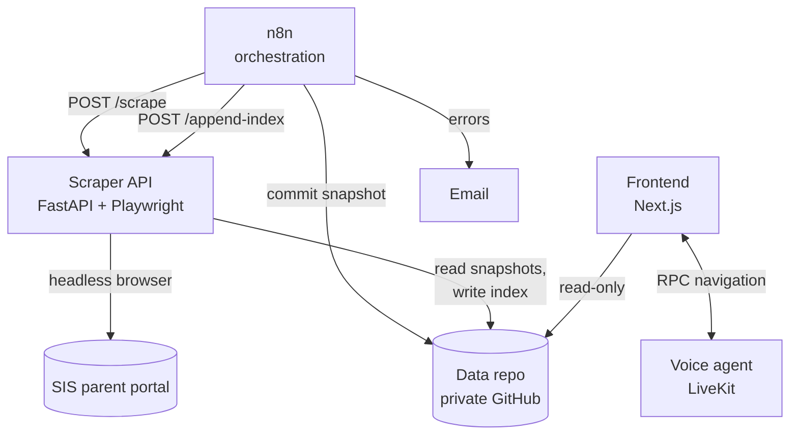
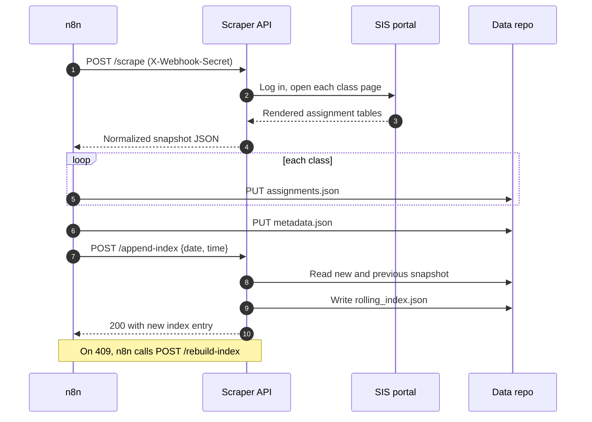

The system is split into isolated pieces that each do one job and hold only the credentials that job needs. n8n sits in the middle and decides what happens to data. Everything else either produces data or reads it.

## The boundaries

<Tabs>
  <Tab title="Orchestration">
    **n8n**, self-hosted behind a Caddy reverse proxy.

    Runs the daily schedule, calls the scraper, commits each class's snapshot to the data repo through the GitHub Contents API, updates the rolling index, and sends error notifications. Conditional logic lives here, not in application code.

    See [n8n workflow](/guides/n8n-workflow).
  </Tab>
  <Tab title="Collection">
    **Scraper API**, a FastAPI service in a Docker container on a managed container runtime.

    `/scrape` logs in to the portal with Playwright, extracts each class's assignment table, normalizes it, and returns JSON. It writes nothing. The index endpoints read snapshots from the data repo and write the rolling index.

    New SIS platforms plug in through a `TableSource` abstraction without changes to n8n.
  </Tab>
  <Tab title="Storage">
    **Data repo**, a private GitHub repository separate from the code repository.

    Holds snapshot JSON and the rolling index, nothing else. Git history is the audit log.

    See [Data model](/concepts/data-model).
  </Tab>
  <Tab title="Presentation">
    **Frontend**, a Next.js app on Vercel.

    Server components read the rolling index and snapshots from the data repo on each request. The calendar uses pre-computed counts; the day view diffs two snapshots in the browser. Optional HTTP basic auth protects the whole site.
  </Tab>
  <Tab title="Voice agent">
    **LiveKit agent**, in a separate repository.

    Answers spoken or typed questions about grades and changes, and navigates the browser to the relevant view over LiveKit RPC. The frontend provides the widget and a token endpoint.
  </Tab>
</Tabs>

## What each boundary is trusted with

| Boundary | Holds | Does not hold |
| --- | --- | --- |
| n8n | GitHub token with write access for snapshot commits, webhook secret, email credentials | SIS credentials |
| Scraper API | SIS credentials, webhook secret, GitHub token for the rolling index | Email credentials |
| Frontend | Read-only GitHub token, basic auth credentials, LiveKit keys | SIS credentials, webhook secret |

## A daily run

## Design choices

<AccordionGroup>
  <Accordion title="Why does n8n own the data flow?">
    The scraper's job is to collect. If it also decided where data goes and who gets notified, every new notification channel or storage target would mean a code change and a redeploy. With n8n as the orchestrator, those become workflow branches, and every execution is logged with its full input and output.
  </Accordion>
  <Accordion title="Why store snapshots in Git?">
    Each snapshot becomes a timestamped commit that cannot be quietly edited. That is the property the project exists to provide. JSON files in a repository are also enough for one student over a school year; a database can be added later without changing the snapshot format.
  </Accordion>
  <Accordion title="Why pre-compute some diffs and not others?">
    The calendar needs a change count for every day in a month. Fetching and diffing dozens of snapshots per page view would be slow, so those counts live in the rolling index. Detail views need only two snapshots, so they are diffed on demand from the raw files. See [Change detection](/concepts/change-detection).
  </Accordion>
</AccordionGroup>
