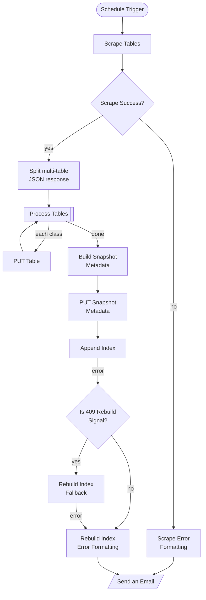

n8n is the control plane. The scraper returns data and stops; n8n decides where that data goes, what to do when a step fails, and who hears about it. The exported workflow is in the repository at `n8n/table-mutation-data-orchestrator.json`.

<Frame caption="The scrape pipeline in the n8n editor">
  
</Frame>

The diagram below shows the same flow with each branch labeled.



## The success path

<Steps>
  <Step title="Schedule Trigger">
    Starts a run on whatever cadence you configure, in the instance's time zone. Once a day is enough for most portals; more frequent runs raise the chance of bot-detection challenges.
  </Step>
  <Step title="Scrape Tables">
    HTTP Request to `POST /scrape`. The `X-Webhook-Secret` header comes from an n8n Header Auth credential, so the secret never appears in the exported workflow.
  </Step>
  <Step title="Scrape Success?">
    The scraper returns HTTP 200 even when the scrape fails, with `status: "error"` in the body. This IF node branches on that field, which keeps failures visible as data rather than as opaque HTTP errors.
  </Step>
  <Step title="Split multi-table JSON response and Process Tables">
    A Code node turns the response into one item per class. A Loop Over Items node sends them one at a time to **PUT Table**, which commits `assignments.json` through the GitHub Contents API.
  </Step>
  <Step title="Build Snapshot Metadata and PUT Snapshot Metadata">
    After the last class, a Code node assembles `metadata.json` from the scrape response and commits it.
  </Step>
  <Step title="Append Index">
    HTTP Request to `POST /append-index` with the snapshot's `date` and `time`. The scraper diffs it against the previous snapshot and appends the entry to the rolling index.
  </Step>
</Steps>

## The fallback path

`/append-index` refuses a snapshot older than the newest index entry and returns HTTP 409. That happens if a run is replayed out of order or the index has drifted.

**Is 409 Rebuild Signal?** checks the error's status code. On a 409, **Rebuild Index Fallback** calls `POST /rebuild-index`, which recomputes the whole index from every snapshot. Any other error goes straight to notification.

## Error handling

Both failure branches format a message and route it to **Send an Email**:

- **Scrape Error Formatting** covers login failures, portal changes, and anything else that stops the scrape.
- **Rebuild Index Error Formatting** covers HTTP-level failures from **Append Index** other than 409, such as a timeout or a 401, and HTTP-level failures from **Rebuild Index Fallback**.

The scrape failure email shows the scraper's error message and an error ID. The scraper logs the full stack trace under that ID, so search its logs for the ID to find the trace. See [Find the stack trace for an error](/operations/troubleshooting#find-the-stack-trace-for-an-error).

## Credentials

| Credential | Type | Used by |
| --- | --- | --- |
| Scraper webhook secret | Header Auth | Scrape Tables, Append Index, Rebuild Index Fallback |
| GitHub token with write access to the data repo | Header Auth | PUT Table, PUT Snapshot Metadata |
| Email | SMTP | Send an Email |

## Environment variables

The workflow reads deployment-specific values from `$env` on the n8n host, so the exported workflow contains no hosts, addresses, or repository names. Set these variables in the n8n instance's environment before you import or run the workflow:

| Variable | Example | Used by |
| --- | --- | --- |
| `SCRAPER_BASE_URL` | `https://<scraper-host>` | Scrape Tables, Append Index, Rebuild Index Fallback. Omit the trailing slash; the nodes append `/scrape`, `/append-index`, and `/rebuild-index`. |
| `DATA_REPO` | `<owner>/<data-repo>` | Split multi-table JSON response and Build Snapshot Metadata, which build the GitHub Contents API URLs for snapshot commits. |
| `ALERT_EMAIL` | `alerts@example.com` | Send an Email, as both the sender and the recipient. |

```bash
SCRAPER_BASE_URL=https://<scraper-host>
DATA_REPO=<owner>/<data-repo>
ALERT_EMAIL=alerts@example.com
```

n8n must allow expressions to read environment variables. If `N8N_BLOCK_ENV_ACCESS_IN_NODE` is `true` on your instance, set it to `false`.

Because these values stay on the n8n host, you can commit an export from the live instance as is. A repository test fails if a committed workflow export or docs page contains a deployment host, a personal email address, or the data repository path.

## n8n behaviors worth knowing

<AccordionGroup>
  <Accordion title="Use JSON body mode for requests to the scraper">
    An HTTP Request node in **Raw** body mode with a `JSON.stringify(...)` expression double-encodes the body, and FastAPI rejects it with a 422. Set **Body Content Type** to JSON and **Specify Body** to JSON instead.
  </Accordion>
  <Accordion title="$json changes after every HTTP Request node">
    Downstream of an HTTP Request node, `$json` is that node's response, not the original input. Reference earlier data explicitly, for example `$('Scrape Tables').first().json.data`.
  </Accordion>
  <Accordion title="Import always creates a new workflow">
    The Import option in the editor never updates an existing workflow. To change one in place, use the REST API: `PUT /api/v1/workflows/{id}` with an `X-N8N-API-KEY` header.
  </Accordion>
  <Accordion title="A credential dropdown shows 'No credentials yet'">
    The node still references a credential ID that was deleted. Switch **Authentication** to None and back, then select the current credential.
  </Accordion>
  <Accordion title="Set HTTP Request timeouts above the platform's">
    A full scrape, with its deliberate delays between pages, can take more than a minute, so **Scrape Tables** and **Rebuild Index Fallback** use a 300-second timeout. **Append Index** does constant work per snapshot and uses 30 seconds. The container platform's own load balancer timeout can be shorter than n8n's; see [Troubleshooting](/operations/troubleshooting).
  </Accordion>
</AccordionGroup>
